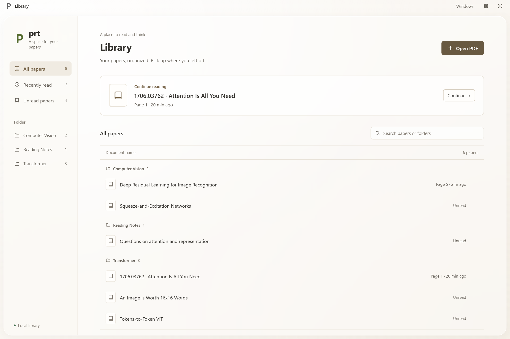

# prt

**Read the paper. Understand the ideas.**

[简体中文](README.md) · **English**

A local PDF reader for Windows, with translation, paper chat, and notes beside the original.

[Download for Windows](https://github.com/975952/prt/releases/latest/download/prt.exe) · [Quick start](docs/quick-start.en.md) · [Report an issue](https://github.com/975952/prt/issues/new/choose)

Actual v1.2.2 interface with a synthetic demonstration library. [Screenshot details](docs/assets/README.md).

## Pick up where you left off

Browse **All papers, Recent, Unread, or folders** from the sidebar. Search by filename or folder, and use the dedicated continue-reading card to return to your saved page. Import and library management stay within reach.

Paper: [Attention Is All You Need](https://arxiv.org/abs/1706.03762). The answer is illustrative.

## A workspace for reading

| Task | In prt |
| --- | --- |
| Find your next paper | Library search, recent and unread filters, folders, and continue reading |
| Compare papers | Tabs, separate windows, window tiling, and saved reading positions |
| Understand a passage | Selection translation, explanations, source comparison, direct deletion of individual results, and clickable citations |
| Discuss figures | Screenshot selection, long captures, vision-model questions, equations, and tables |
| Continue a discussion | Folder conversations, history, cross-window sync, and saved drafts |
| Keep your bearings | Full-text search, outlines, highlights, notes, and reference lookup |
| Read comfortably | Glass, Rice paper, and Dark themes; adjustable transparency, blur, and night text brightness |
| Choose your language | Simplified Chinese and English throughout the interface; separate answer and translation languages |

## Get started

1. Download **prt.exe** from [Releases](https://github.com/975952/prt/releases/latest) and put it in a writable folder.
2. Open it and import or drag in a PDF. Reading, search, and notes work without an AI service.
3. For AI features, enter an OpenAI-compatible service URL, model name, and API key in Settings. Image questions require a vision-capable model.
4. In **Settings → 语言 / Language**, select **English** and apply. You can set the answer language separately; the translation target stays independent.

No installation or Node.js is required for the desktop app. Windows 10/11 x64 and [WebView2 Runtime](https://developer.microsoft.com/microsoft-edge/webview2/) are required. You supply your own model service; provider charges may apply.

**Current release:** [v1.2.2](https://github.com/975952/prt/releases/tag/v1.2.2). The rounded library home supports `Ctrl+plus` / `Ctrl+minus` zoom and `Ctrl+0` reset. Numeric PDF filenames gain locally detected paper titles, which are also searchable. Drag the floating translation card's lower-right corner to resize it. Glass now uses a near-white, subtly warm background, with 12% page transparency, 88% interface transparency, and a separate crystal intensity control. Individual translations can still be deleted immediately without confirmation.

## Your data

Papers are stored in `papers/` beside the EXE. Settings, API keys, notes, conversations, and drafts are stored in `data/`. Keep both folders when upgrading or moving the app. Do not publish `data/` or attach it to an issue.

The local service listens on `127.0.0.1`. AI requests send the relevant text, images, and conversation context to your configured provider. Online search sends queries to search services. Verify important claims against the original paper.

## Help and feedback

- **Help:** [Quick start](docs/quick-start.en.md) · [Documentation](docs/README.md)
- **Feedback:** [Report an issue or suggest a feature](https://github.com/975952/prt/issues/new/choose) · [Security policy](SECURITY.md)
- **Contribute:** [Contribution guide](CONTRIBUTING.md) · [Build from source](docs/开发指南.md)

Detailed contributor guides are currently in Chinese.

## License

Project code is licensed under [MIT](LICENSE). Third-party components and papers retain their own licenses; the paper shown in screenshots is not covered by this project's MIT license. See [third-party notices](docs/第三方组件.md).
