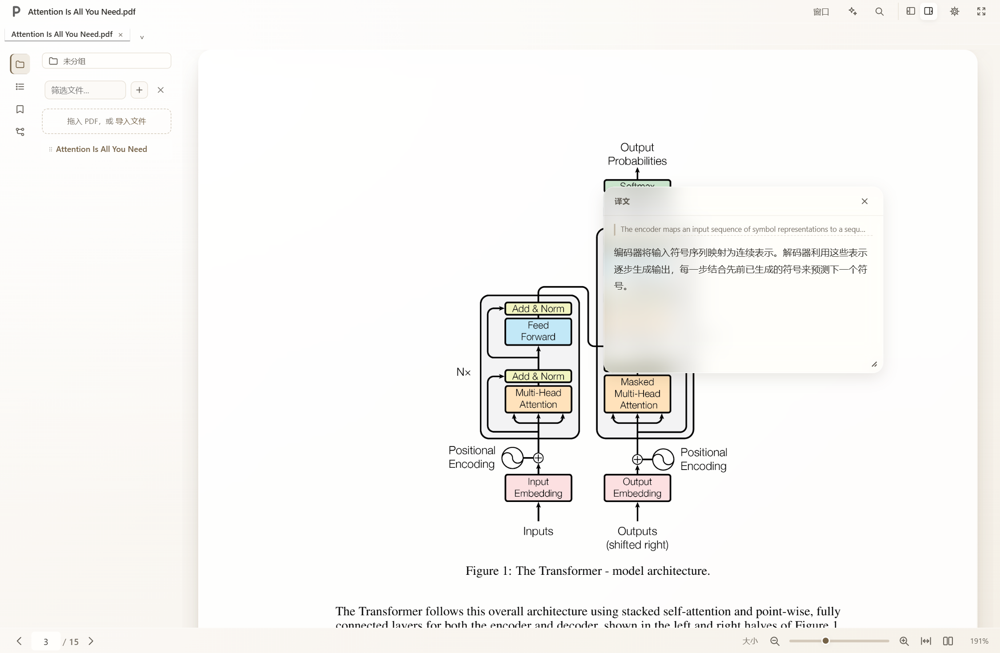

# prt

**Read the paper. Understand the ideas.**

[简体中文](README.md) · **English**

A local PDF reader for Windows, with translation, paper chat, and notes beside the original.

[Download for Windows](https://github.com/975952/prt/releases/latest/download/prt.exe) · [Quick start](docs/quick-start.en.md) · [Report an issue](https://github.com/975952/prt/issues/new/choose)

Actual v1.2.5 interface with a synthetic demonstration library. [Screenshot details](docs/assets/README.md).

## Pick up where you left off

Browse **All papers, Recent, Unread, or folders** from the sidebar. Search by filename or folder, and use the dedicated continue-reading card to return to your saved page. Import and library management stay within reach.

Paper: [Attention Is All You Need](https://arxiv.org/abs/1706.03762). The answer is illustrative.

## A workspace for reading

| Task | In prt |
| --- | --- |
| Find your next paper | Library search, recent and unread filters, folders, and continue reading |
| Compare papers | Tabs, separate windows, window tiling, and saved reading positions |
| Understand a passage | Selection translation, explanations, source comparison, direct deletion of individual results, and clickable citations |
| Discuss figures | Screenshot selection, long captures, vision-model questions, equations, and tables |
| Continue a discussion | Per-paper or shared folder conversations, background generation, cross-window sync, and saved drafts |
| Keep your bearings | Full-text search, outlines, highlights, notes, and reference lookup |
| Read comfortably | Glass, Rice paper, and Dark themes; adjustable PDF elevation, edge highlights, translation card materials, and night text brightness |
| Choose your language | Simplified Chinese and English throughout the interface; separate answer and translation languages |

## Get started

1. Download **prt.exe** from [Releases](https://github.com/975952/prt/releases/latest) and put it in a writable folder.
2. Open it and import or drag in a PDF. Reading, search, and notes work without an AI service.
3. For AI features, enter an OpenAI-compatible service URL, model name, and API key in Settings. Image questions require a vision-capable model.
4. The interface starts in **English**. Use **Settings → Language / 语言** to switch between English and Simplified Chinese. The answer language and translation target can be set separately.

No installation or Node.js is required for the desktop app. Windows 10/11 x64 and [WebView2 Runtime](https://developer.microsoft.com/microsoft-edge/webview2/) are required. You supply your own model service; provider charges may apply.

**Current release:** [v1.2.9](https://github.com/975952/prt/releases/tag/v1.2.9). Generation belongs to its conversation: switching papers within the same conversation preserves the message view and continues the answer. Switching to another conversation leaves the original task running in the background; returning shows its latest output. Each task keeps the paper materials from when the question was submitted, preventing answers from drifting into a newly opened paper.

Updated appearance defaults include 17px reading text, 140% home zoom, 16% page transparency, 100% interface transparency, and 92% background brightness. All remain adjustable in **Settings → Appearance**. **Translation card material** offers independently saved Liquid glass and Frosted glass settings: Liquid starts at 35% transparency, 11.4px blur, and 99% edge refraction; Frosted starts at 71% transparency and 9.4px blur. See the [quick start](docs/quick-start.en.md#adjust-the-appearance) for the other defaults.

Conversations are managed per paper by default, with history ordered by time. Choose folder sharing in Settings to continue a discussion across papers in the same folder; ungrouped files then share a common root-folder conversation space.

This release also includes recent reading fixes: clearer input highlights and shadows, a 92%–100% background brightness range, up to three translations generating at once in submission order, correct selection boundaries in narrow-column papers, and readable pastel diagram backgrounds in dark mode. **Search paper in browser** opens the default browser with a Bing query from citation cards and reference lists.

Preview both translation card materials

The cards show illustrative Chinese translations in the actual desktop interface. Both materials have adjustable, independently saved settings.

## Your data

Papers are stored in `papers/` beside the EXE. Settings, API keys, notes, conversations, and drafts are stored in `data/`. Keep both folders when upgrading or moving the app. Do not publish `data/` or attach it to an issue.

The local service listens on `127.0.0.1`. AI requests send the relevant text, images, and conversation context to your configured provider. Online search sends queries to search services. Verify important claims against the original paper.

## Help and feedback

- **Help:** [Quick start](docs/quick-start.en.md) · [Documentation](docs/README.md)
- **Feedback:** [Report an issue or suggest a feature](https://github.com/975952/prt/issues/new/choose) · [Security policy](SECURITY.md)
- **Contribute:** [Contribution guide](CONTRIBUTING.md) · [Build from source](docs/开发指南.md)

Detailed contributor guides are currently in Chinese.

## License

Project code is licensed under [MIT](LICENSE). Third-party components and papers retain their own licenses; the paper shown in screenshots is not covered by this project's MIT license. See [third-party notices](docs/第三方组件.md).
