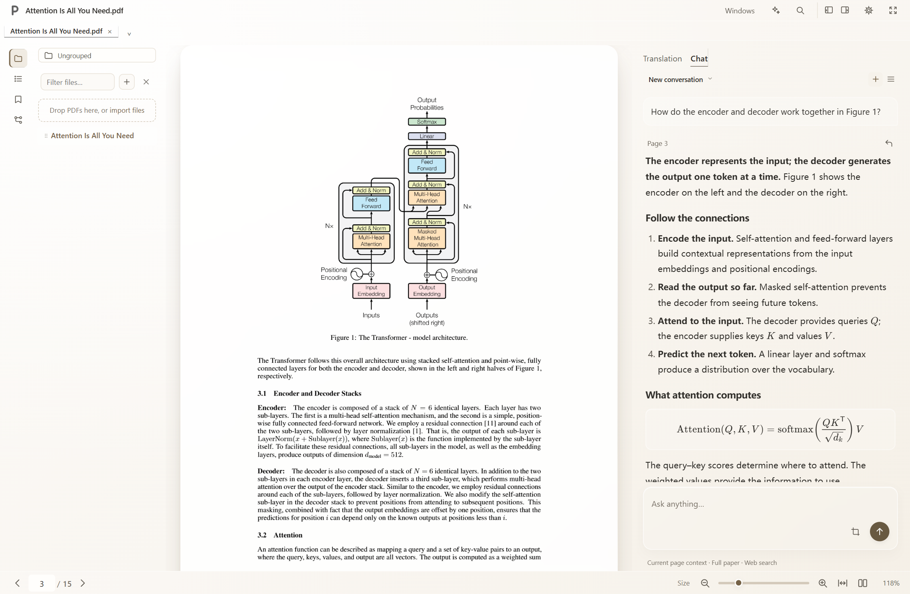
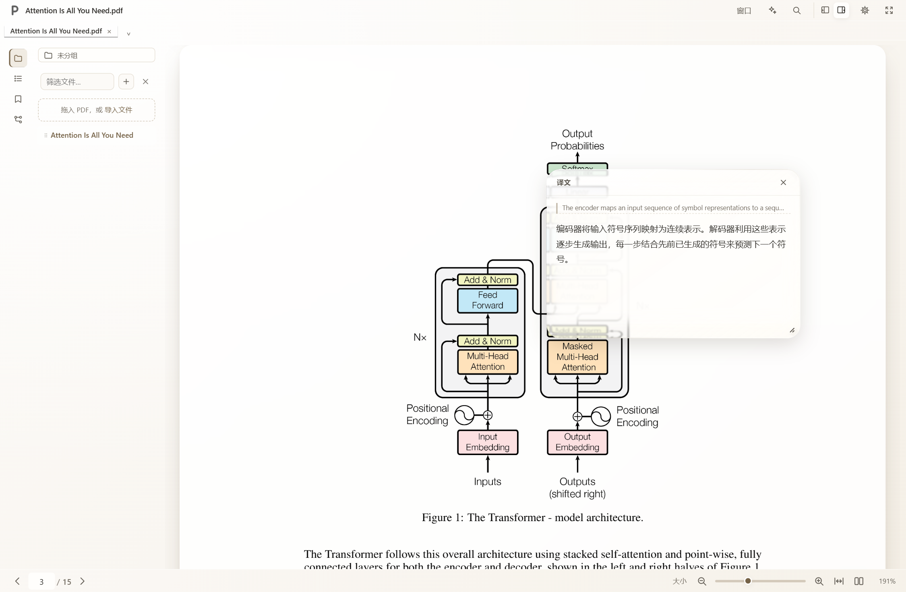

# prt

**Read the paper. Understand the ideas.**

[简体中文](README.md) · **English**

A local PDF reader for Windows: organize papers and books in Library, find material and ask cross-file questions with Alina, then return to the original for page references, translation, and notes. Available as an installer or portable app, with your files stored locally.

[Download installer](https://github.com/975952/prt/releases/latest/download/prt-setup.exe) · [Portable app](https://github.com/975952/prt/releases/latest/download/prt.exe) · [Quick start](docs/quick-start.en.md) · [Report an issue](https://github.com/975952/prt/issues/new/choose)

Actual v1.2.5 interface with a synthetic demonstration library. [Screenshot details](docs/assets/README.md).

## Library, Alina, and the reader

Start in Library by default, or choose the reader or Alina in settings. Alina places the reading, paper search, and resume-chat actions together below the input. New chat stays in the sidebar, with a bubble-plus icon when collapsed. Workspace switches preserve reading position and conversations.

PDF organization uses filenames first, then first-page text or images when needed. It proposes flat topic folders, groups similar documents, and preserves existing organization where appropriate. Each classification replaces previous suggestions; files move only after preview and confirmation. Library has a resizable sidebar and shares Alina's dark background.

Saving model changes tests the connection immediately; saving unchanged settings closes the dialog. Source citations show the full document title and page number, with a link back to the original.

Browse **All papers, Recent, Unread, or folders** from the sidebar. Search by filename or folder, and use the dedicated continue-reading card to return to your saved page. Import and library management stay within reach. During reading, use the top-bar Home button to browse the library, then select a tab to return with its reading position, zoom, and background generation preserved.

Paper: [Attention Is All You Need](https://arxiv.org/abs/1706.03762). The answer is illustrative.

## A workspace for reading

| Task | In prt |
| --- | --- |
| Find your next paper | Library search, recent and unread filters, folders, and continue reading |
| Compare papers | Tabs across folders, separate windows, window tiling, saved reading positions, and restored tab order after reload |
| Understand a passage | Selection translation, explanations, source comparison, direct deletion of individual results, and clickable citations |
| Discuss figures | Screenshot selection, long captures, vision-model questions, equations, and tables |
| Continue a discussion | Per-paper, shared folder, or global conversations; background generation, cross-window sync, and saved drafts |
| Keep your bearings | Full-text search, outlines, highlights, notes, and reference lookup |
| Read comfortably | Fit width fills the reading area, fullscreen keeps navigation visible, and Glass, Rice paper, and Dark themes offer adjustable materials |
| Choose your language | Simplified Chinese and English throughout the interface; separate answer and translation languages |

## Get started

1. Download **prt-setup.exe** from [Releases](https://github.com/975952/prt/releases/latest) and install it for your Windows account. Administrator privileges are not required.
2. Open **prt** from the Start menu or desktop shortcut and import or drag in a PDF. Reading, search, and notes work without an AI service.
3. For AI features, enter an OpenAI-compatible service URL, model name, and API key in Settings. Image questions require a vision-capable model.
4. The interface starts in **English**. Use **Settings → Language / 语言** to switch between English and Simplified Chinese. The answer language and translation target can be set separately.

Windows 10/11 x64 and [WebView2 Runtime](https://developer.microsoft.com/microsoft-edge/webview2/) are required; the installer checks for the runtime. Node.js is not needed. For an app that runs without installation, download **prt.exe** into a writable folder. You supply your own model service; provider charges may apply.

**Current release:** [v1.3.0](https://github.com/975952/prt/releases/tag/v1.3.0). Adds a Windows setup wizard, Start menu and desktop shortcuts, upgrades, and an uninstaller. The installed app keeps program files separate from papers and conversation data. Upgrades preserve your files, and uninstalling keeps personal data. During first installation, you can select a portable copy to copy its papers, settings, and conversations; the original folder remains intact.

Switching between folders keeps open tabs, and reloading restores their order. Fullscreen keeps the tab bar and Home button visible, and generation continues while you browse Home. **Fit width** fills the available reading area and adapts when sidebars or window size change.

Questions can target other imported files and specific pages without scanning an entire textbook. Scanned pages are supplied as images, and comparisons keep each file's page numbers separate. Generation stays with its conversation through navigation; cancellation, retries and ordered saves prevent late results from entering another conversation or replacing a newer answer.

Updated appearance defaults include 17px reading text, 140% home zoom, 16% page transparency, 100% interface transparency, and 92% background brightness. All remain adjustable in **Settings → Appearance**. **Translation card material** offers independently saved Liquid glass and Frosted glass settings: Liquid starts at 35% transparency, 11.4px blur, and 99% edge refraction; Frosted starts at 71% transparency and 9.4px blur. See the [quick start](docs/quick-start.en.md#adjust-the-appearance) for the other defaults.

Conversations are managed per paper by default, with history ordered by time. Choose folder sharing in Settings to continue a discussion across papers in the same folder; ungrouped files then share a common root-folder conversation space.

This release also includes recent reading fixes: clearer input highlights and shadows, a 92%–100% background brightness range, up to three translations generating at once in submission order, correct selection boundaries in narrow-column papers, and readable pastel diagram backgrounds in dark mode. **Search paper in browser** opens the default browser with a Bing query from citation cards and reference lists.

Preview both translation card materials

The cards show illustrative Chinese translations in the actual desktop interface. Both materials have adjustable, independently saved settings.

## Your data

| Content | Installed app | Portable app |
| --- | --- | --- |
| Program | `%LOCALAPPDATA%\Programs\prt` | The folder containing `prt.exe` |
| Paper library | `prt\papers` inside your Windows Documents folder | `papers/` beside the EXE |
| Settings, notes, conversations, API keys, and window data | `%LOCALAPPDATA%\prt\data` | `data/` beside the EXE |

The installed app follows the Windows Documents folder, including redirected locations or OneDrive. Close prt before backing up both the library and data folders. Uninstalling preserves them. Migration copies into empty destinations and refuses to merge or overwrite existing data. Import requires ordinary local source and destination directories; links, junctions, and cloud placeholder paths stop the import with an explanation. Do not publish your data folder or attach it to an issue.

To upgrade the installed app, close prt and run the latest **prt-setup.exe**. For the portable app, replace **prt.exe** in its original folder and keep `papers/` and `data/`. Releases include a source archive and `SHA256SUMS.txt`.

The local service listens on `127.0.0.1`. AI requests send the relevant text, images, and conversation context to your configured provider. Online search sends queries to search services. Verify important claims against the original paper.

## Help and feedback

- **Help:** [Quick start](docs/quick-start.en.md) · [Documentation](docs/README.md)
- **Feedback:** [Report an issue or suggest a feature](https://github.com/975952/prt/issues/new/choose) · [Security policy](SECURITY.md)
- **Contribute:** [Contribution guide](CONTRIBUTING.md) · [Build from source](docs/开发指南.md)

Detailed contributor guides are currently in Chinese.

## License

Project code is licensed under [MIT](LICENSE). Third-party components and papers retain their own licenses; the paper shown in screenshots is not covered by this project's MIT license. See [third-party notices](docs/第三方组件.md).
