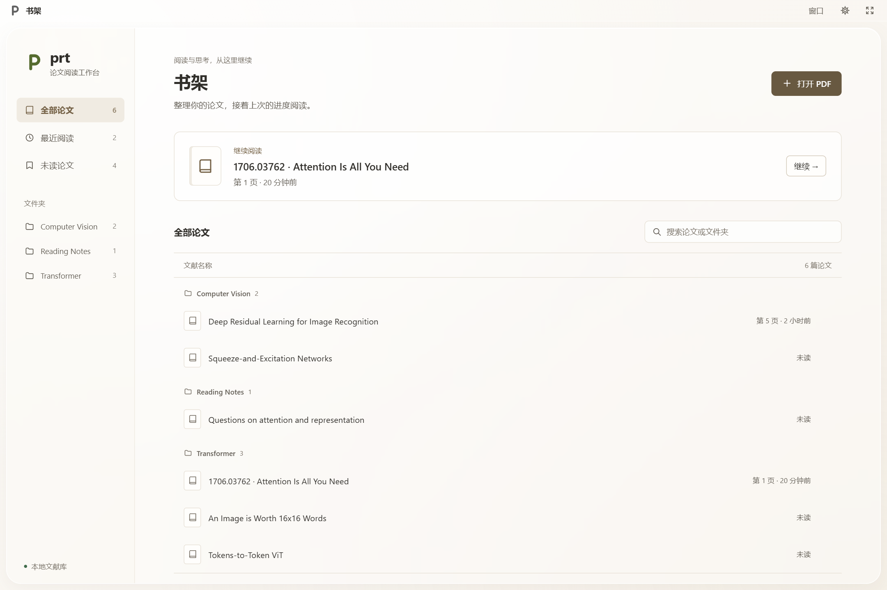
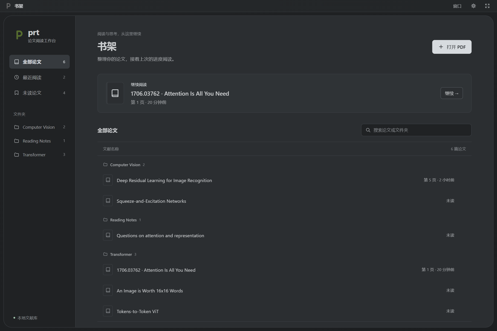

# prt

**在论文旁边，把问题读明白。**

**简体中文** · [English](README.en.md)

面向 Windows 的本地 PDF 阅读器，将原文、翻译、问答与笔记放在同一个工作区。

[下载 Windows 版](https://github.com/975952/prt/releases/latest/download/prt.exe) · [使用指南](docs/使用说明书.md) · [更新记录](CHANGELOG.md) · [反馈问题](https://github.com/975952/prt/issues/new/choose)

v1.2.2 实际界面；书架使用独立演示数据。[截图说明](docs/assets/README.md)

## 从书架回到阅读

首页集中展示论文和阅读进度：左侧切换**全部论文、最近阅读、未读与文件夹**，右侧搜索文件名或目录。独立的“继续阅读”入口回到上次阅读的位置，导入与整理入口始终可见。

论文为 [Attention Is All You Need](https://arxiv.org/abs/1706.03762)；右侧问答是演示内容。

## 为阅读准备的工作区

| 从阅读到理解 | 在 prt 中完成 |
| --- | --- |
| 找到下一篇论文 | 首页搜索、最近阅读、未读筛选、文件夹导航与继续阅读 |
| 对照多篇论文 | 多标签、独立窗口与窗口平铺，保留各自的阅读位置 |
| 读懂一段原文 | 划词翻译、解释、原文对照；每条译文可直接删除，点击引用回到对应页面 |
| 看图表与公式 | 框选截图、长截图、视觉模型问答，支持公式与表格排版 |
| 连贯地追问 | 同文件夹会话、跨窗口同步、输入草稿与翻译任务恢复 |
| 留下阅读线索 | 全文搜索、目录、高亮笔记与参考文献检索 |
| 调整阅读观感 | 透光、米宣与深色主题，可调透明、磨砂、字号及夜读文字亮度 |
| 使用自己的语言 | 简体中文 / English 全局界面；回答语言与翻译目标分别设置 |

## 开始使用

1. 从 [Releases](https://github.com/975952/prt/releases/latest) 下载 **prt.exe**，放入一个可写文件夹。
2. 双击启动，拖入 PDF 或点击导入，即可阅读、搜索和记笔记。
3. 需要翻译或问答时，在设置中填写 **OpenAI 兼容接口地址、模型名和 API Key**。图表与扫描件需要支持图像的模型。

在 **设置 → 语言 / Language** 中切换简体中文或 English。界面切换会保存当前阅读位置、会话和草稿；回答语言可跟随界面或独立选择，翻译目标保持单独设置。

桌面版免安装，无需 Node.js。支持 Windows 10/11 x64，需要 [Microsoft WebView2 Runtime](https://developer.microsoft.com/microsoft-edge/webview2/)（多数系统已安装）。模型服务由你自行配置，服务费用按对应提供商规则计算。

**当前版本：** [v1.2.2](https://github.com/975952/prt/releases/tag/v1.2.2)。首页采用圆角布局，支持 `Ctrl+加号` / `Ctrl+减号` 缩放、`Ctrl+0` 复位；数字 PDF 文件名后会自动补出可识别的论文标题，也能按标题搜索。浮动译文卡片可拖动右下角调整大小。透光主题采用近白、微暖背景，默认纸面透明度 12%、界面透明度 88%，水晶高光可单独调节。每条译文仍可直接删除，无确认弹窗。

升级时，退出旧版并替换同一目录的 `prt.exe`，保留 `papers/` 和 `data/`。下载页提供 `SHA256SUMS.txt` 校验文件。

查看米宣与深色主题

### 深色首页

### 米宣

### 深色

## 数据由你保管

论文保存在程序旁的 `papers/`，配置、笔记、会话和 API Key 保存在 `data/`。备份或迁移时，将两个目录一起复制。API Key 作为本地配置保存，请妥善保管该目录。

本地服务只监听 `127.0.0.1`。阅读、搜索和笔记不需要模型服务；使用 AI 时，相关原文、截图及对话上下文会发送到你配置的接口，联网检索会向检索服务发送查询。AI 输出可能有误，可通过引用回到原文核对。

## 帮助与反馈

- **使用：** [使用指南](docs/使用说明书.md) · [多窗口阅读](docs/多窗口阅读.md) · [常见问题](docs/使用说明书.md#常见问题)
- **反馈：** [报告问题或提出建议](https://github.com/975952/prt/issues/new/choose) · [安全问题](SECURITY.md)
- **参与：** [贡献指南](CONTRIBUTING.md) · [文档索引](docs/README.md)

## 许可证

项目代码采用 [MIT License](LICENSE)。第三方组件、字体和论文分别遵循各自的授权；截图中的论文不属于本项目的 MIT 授权范围。参见 [第三方组件](docs/第三方组件.md)。
