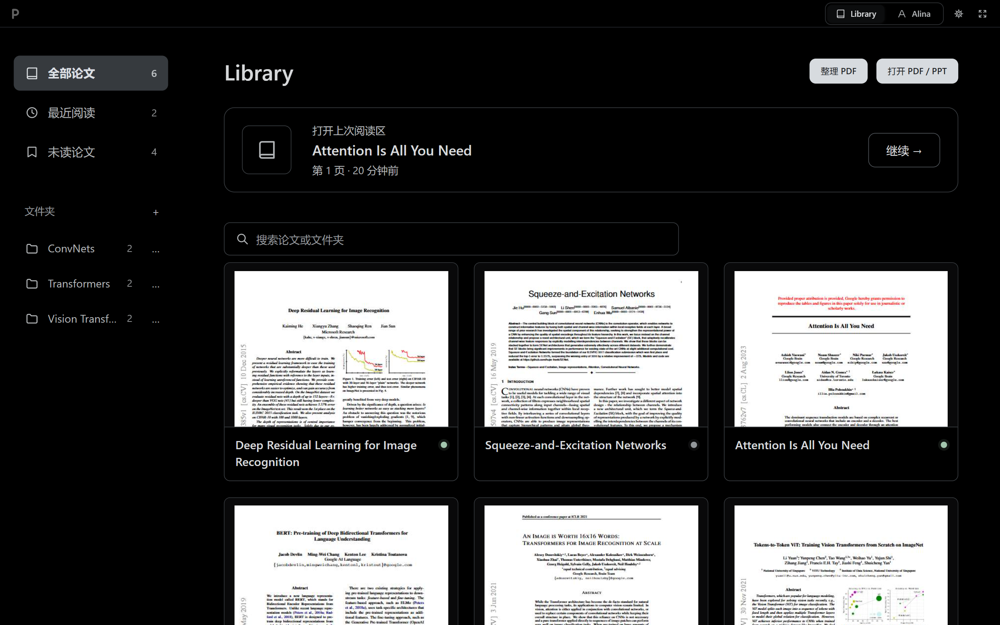
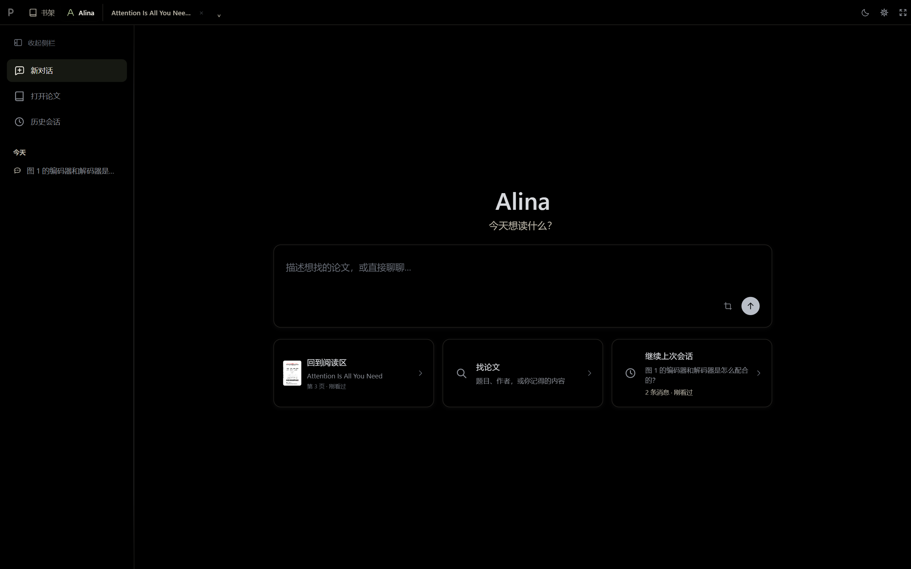
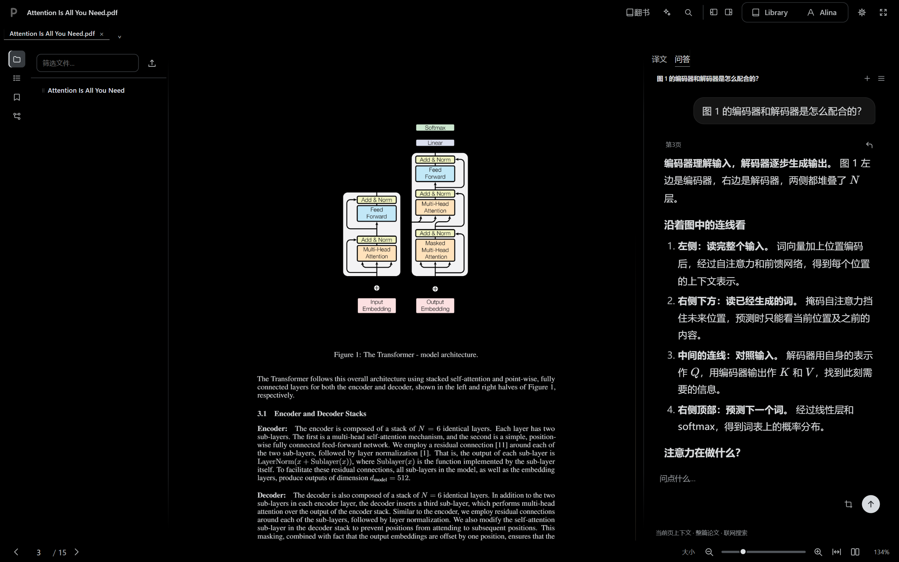

# prt

**读到哪，问到哪。**

**简体中文** · [English](README.en.md)

prt 是一款带 AI 问答的 Windows 本地 PDF 阅读器，支持整份课程或论文文件夹拖入，递归导入 PDF、PPT、PPTX 并保留目录结构。用 Library 整理讲义和论文，在阅读区划词翻译、截取图表提问，也可以到 Alina 继续讨论。两个界面共用会话历史，比较多篇论文时可以沿着回答里的页码回到对应原文。

[下载安装版](https://github.com/975952/prt/releases/latest/download/prt-setup.exe) · [便携版](https://github.com/975952/prt/releases/latest/download/prt.exe) · [使用指南](docs/使用说明书.md) · [更新记录](CHANGELOG.md) · [反馈问题](https://github.com/975952/prt/issues/new/choose)

## 三个工作区 · v1.4.6 深色模式

深色主题下的书架，封面来自 ViT、ResNet 等六篇公开论文的原始 PDF。[论文来源与截图说明](docs/assets/README.md)

论文为 [Attention Is All You Need](https://arxiv.org/abs/1706.03762)；右侧问答是演示内容。

## 主要功能

| 使用场景 | 在 prt 中完成 |
| --- | --- |
| **考试复习** | 导入 PDF 讲义和 PPT/PPTX 课件，让 AI 辅助梳理知识点、解释难点，并结合多份资料提问 |
| **资料整理** | 拖入整个文件夹，按原目录结构导入课件与论文；AI 辅助分类，预览并调整方案后再移动文件，支持回退整理记录 |
| **论文阅读** | 划词翻译、原文解释、全文问答；框选截图或长截图提问，辅助理解公式、图表与扫描页 |
| **跨文件查找与对照** | 搜索单篇、文件夹或整个书架，跨文件问答并保留各自页码；点击来源回到原文，多标签、多窗口并排阅读 |
| **查找论文与参考资料** | 按标题、研究主题或内容描述查找本地论文，也可联网检索；整理参考文献，网络结果有可用 PDF 链接时可手动导入 |
| **笔记与会话** | 高亮、记笔记、按文档保存译文；在阅读区和 Alina 打开同一段会话，追问写回原会话 |
| **个人 AI 助手** | Alina 可独立聊天，结合学习记忆调整讲解；可选人格模式支持定制名字、性格与交流习惯 |
| **阅读体验** | 连续阅读、沉浸翻书与横向课件单页展示；透光、米宣、深色主题，支持简体中文、English、Filipino、Deutsch 界面及独立的回答、翻译语言设置 |

PPT/PPTX 导入通过 **Windows 本机已安装的 Microsoft PowerPoint 转换为 PDF** 后阅读，不提供原生幻灯片编辑。AI 功能使用你配置的模型接口；图表、截图与扫描页问答需要支持图像的模型。

拖入文件夹时保留原有层级，跳过隐藏名称、系统杂项与不含可导入文件的空目录。拖到书架或阅读侧栏的文件夹行即可指定目标，同名目录自动追加编号。导入后自动展开目标的父目录并刷新文件树，让嵌套位置立即可见。

## Library、Alina 与阅读区

**v1.4.7** 新增菲律宾语（Filipino）和德语（Deutsch），可分别用于界面、AI 回答与翻译目标。切换语言保留阅读位置和草稿；已有翻译在重启或重试后继续使用原目标语言。

**v1.4.6** 完善了工作区切换和资料整理：没有阅读记录时也能正常返回书架；AI 分类会继续读取重新分组后仍无法判断的论文首页，并展示原因。删除含子文件夹的目录时，可选择保留内部结构并上移一级，或将论文打平到根目录。同名子文件夹自动编号，论文冲突或其他文件会保留原目录，避免覆盖资料。

默认从 Library 打开，也可在设置中选择恢复阅读区或进入 Alina。Alina 首页将“打开上次阅读区”“找论文”“继续上次会话”并列展示；新对话位于侧栏，收起时保留气泡加号入口。切换工作区保留当前阅读位置与会话。

整理 PDF 优先按文件名判断，信息不足时再读取第一页文字或图片。分类采用一层目录，相似资料放在一起，已有合理分类尽量保留；每次重新分类覆盖旧建议，预览确认后才移动文件。Library 侧栏可拖动调宽，深色背景与 Alina 统一。

来源引用显示完整资料标题与页码，点击即可跳回对应原文。Alina 可在独立页面聊天，也可以随阅读切换到侧栏，按单篇资料、文件夹或全局延续讨论。

阅读区另有独立的**沉浸翻书**模式：常规竖向资料采用双页与仿真折页，横向课件采用单页展示，顶底工具栏自动收起。翻译与问答使用可拖动的浮动卡片，译文自动保留，支持历史、原文对照、复制与存笔记。原有 F11 全屏仍保留连续阅读布局。

首页集中展示论文和阅读进度：左侧切换**全部论文、最近阅读、未读与文件夹**，右侧搜索文件名或目录。独立的“继续阅读”入口回到上次阅读的位置，导入与整理入口始终可见。阅读时可随时点击顶栏“首页”浏览书架，再点标签继续阅读；原来的位置、缩放与后台生成保留。

## 开始使用

1. 从 [Releases](https://github.com/975952/prt/releases/latest) 下载 **prt-setup.exe**，按向导安装到当前 Windows 账户，无需管理员权限。
2. 从开始菜单或桌面快捷方式打开 **prt**，拖入 PDF、PPT/PPTX 或整个文件夹，也可点击导入选择文件。
3. 需要翻译或问答时，在设置中填写 **OpenAI 兼容接口地址、模型名和 API Key**。图表与扫描件需要支持图像的模型。

首次使用默认显示 English，可在 **Settings → Language / 语言** 中选择简体中文、English、Filipino（菲律宾语）或 Deutsch（德语）。界面切换会保存当前阅读位置、会话和草稿；回答语言可跟随界面或独立选择，翻译目标保持单独设置。

支持 Windows 10/11 x64，无需 Node.js，需要 [Microsoft WebView2 Runtime](https://developer.microsoft.com/microsoft-edge/webview2/)（多数系统已安装）。安装器会检查运行环境；模型服务由你自行配置，服务费用按对应提供商规则计算。需要免安装或放在移动硬盘时，下载 **prt.exe** 到可写文件夹即可。

**[最新版](https://github.com/975952/prt/releases/latest)** 提供 Windows 安装向导、开始菜单与桌面快捷方式、升级与卸载入口。安装版将程序、论文和会话分开保存；升级不覆盖资料，卸载保留个人数据。首次安装可选择旧便携版所在目录，复制论文、设置和会话，原目录保持完整。

跨文件夹切换保留已打开的标签，刷新后恢复原顺序；全屏保留标签栏与“首页”入口，回首页后任务继续生成。**Fit width / 适应宽度** 铺满阅读区可用宽度，开关侧栏和调整窗口时继续贴合。

跨文件问答先定位目标资料，指定页只读该页，扫描页直接读图；多文件比较分别保留页码。生成跟随所属会话，切换文件或会话时继续运行；停止、重试和保存分别校验任务归属，防止迟到内容串入其他对话或覆盖新答案。

默认外观已更新：阅读字号 17px、首页缩放 140%，纸面透明度 16%、界面透明度 100%，背景亮度 92%。在 **设置 → 阅读外观** 可继续调整。**译文卡片材质**提供液态玻璃与磨砂玻璃，两种材质分别记住参数：液态默认通透度 35%、雾化 11.4px、边缘折射 99%；磨砂默认通透度 71%、雾化 9.4px。完整参数见[使用指南](docs/使用说明书.md#外观与舒适度)。

会话历史默认按时间排列，集中显示论文、文件夹和全局对话。从任一工作区打开已有会话，后续消息都会保存到原会话。阅读区新建会话时默认归当前论文，也可在设置中选择按文件夹或全局延续。

在 **设置 → 记忆** 查看、编辑或删除已保存的称呼、偏好、学习记录和当前会话记忆；`Ctrl+Shift+M` 也可直接打开这一页。聊天保存的记忆与卡片使用同一份记录，保存失败时不会显示为已保存。

本版也包含近期的阅读修复：输入框光影更明显，背景亮度范围提高到 92%–100%；多条译文最多三条同时生成、按发起顺序排列；窄栏论文不再混选相邻栏文字，深色阅读保留淡彩色底框的原有色相。引用卡片和参考文献列表中的“浏览器搜索论文”直接打开默认浏览器，使用 Bing 搜索。

prt 启动时自动检查新版（自动检查间隔至少一天），有更新时显示提示；在 **设置 → 应用更新** 点击 **更新并重启**，完成下载、校验和状态保存后自动更新并重启。安装版与便携版都保留论文、会话和设置，网络失败时可继续使用当前版本并重试。

**旧版首次升级：** 旧安装版直接运行本次新版 **prt-setup.exe** 覆盖安装，**无需卸载**；以后即可在应用内更新。旧便携版退出后替换原位置的 **prt.exe**，保留 `papers/` 和 `data/`。手动覆盖升级仍可使用，下载页同时提供源码包与 `SHA256SUMS.txt`。

## 数据由你保管

| 内容 | 安装版默认位置 | 便携版位置 |
| --- | --- | --- |
| 应用程序 | `%LOCALAPPDATA%\Programs\prt` | `prt.exe` 所在目录 |
| 论文库 | 系统“文档”目录下的 `prt\papers` | 程序旁的 `papers/` |
| 设置、笔记、会话、API Key 与窗口数据 | `%LOCALAPPDATA%\prt\data` | 程序旁的 `data/` |

系统“文档”目录若已重定向到其他磁盘或 OneDrive，安装版会跟随系统位置。备份时退出 prt，将论文库与数据目录一起复制；卸载不会删除这两个目录。API Key 作为本地配置保存，不应公开上传数据目录。旧版迁移只向空目标复制，不会合并覆盖已存在的资料；迁移的源和目标需要是普通本地目录，遇到链接、联接点或云端占位路径会停止并提示。完整步骤见[使用指南](docs/使用说明书.md#数据备份与升级)。

本地服务只监听 `127.0.0.1`。阅读、搜索和笔记不需要模型服务；使用 AI 时，相关原文、截图及对话上下文会发送到你配置的接口，联网检索会向检索服务发送查询。AI 输出可能有误，可通过引用回到原文核对。

## 帮助与反馈

- **使用：** [使用指南](docs/使用说明书.md) · [多窗口阅读](docs/多窗口阅读.md) · [常见问题](docs/使用说明书.md#常见问题)
- **反馈：** [报告问题或提出建议](https://github.com/975952/prt/issues/new/choose) · [安全问题](SECURITY.md)
- **参与：** [贡献指南](CONTRIBUTING.md) · [文档索引](docs/README.md)

## 许可证

项目代码采用 [MIT License](LICENSE)。第三方组件、字体和论文分别遵循各自的授权；截图中的论文不属于本项目的 MIT 授权范围。参见 [第三方组件](docs/第三方组件.md)。
