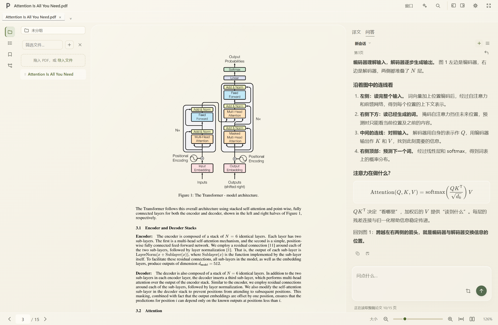

# prt

**在论文旁边，把问题读明白。**

面向 Windows 的本地 PDF 阅读器，将原文、翻译、问答与笔记放在同一个工作区。

[下载 Windows 版](https://github.com/975952/prt/releases/latest/download/prt.exe) · [使用指南](docs/使用说明书.md) · [更新记录](CHANGELOG.md) · [反馈问题](https://github.com/975952/prt/issues/new/choose)

当前主分支界面。论文为 [Attention Is All You Need](https://arxiv.org/abs/1706.03762)；右侧问答是演示内容。[截图来源与复现](docs/assets/README.md)

## 为阅读准备的工作区

| 从阅读到理解 | 在 prt 中完成 |
| --- | --- |
| 对照多篇论文 | 多标签、独立窗口与窗口平铺，保留各自的阅读位置 |
| 读懂一段原文 | 划词翻译、解释、原文对照，点击引用回到对应页面 |
| 看图表与公式 | 框选截图、长截图、视觉模型问答，支持公式与表格排版 |
| 连贯地追问 | 同文件夹会话、跨窗口同步、输入草稿与翻译任务恢复 |
| 留下阅读线索 | 全文搜索、目录、高亮笔记与参考文献检索 |
| 调整阅读观感 | 透光、米宣与深色主题，可调透明、磨砂、字号及夜读文字亮度 |

## 开始使用

1. 从 [Releases](https://github.com/975952/prt/releases/latest) 下载 **prt.exe**，放入一个可写文件夹。
2. 双击启动，拖入 PDF 或点击导入，即可阅读、搜索和记笔记。
3. 需要翻译或问答时，在设置中填写 **OpenAI 兼容接口地址、模型名和 API Key**。图表与扫描件需要支持图像的模型。

桌面版免安装，无需 Node.js。支持 Windows 10/11 x64，需要 [Microsoft WebView2 Runtime](https://developer.microsoft.com/microsoft-edge/webview2/)（多数系统已安装）。模型服务由你自行配置，服务费用按对应提供商规则计算。

**版本说明：** 当前下载版是 **v1.1.1**。上方截图与功能表展示 `main` 的最新实现，其中新主题、草稿恢复和阅读布局优化尚未打入正式 Release。想体验这些改动，可按 [开发指南](docs/开发指南.md) 从源码构建。

升级时，退出旧版并替换同一目录的 `prt.exe`，保留 `papers/` 和 `data/`。下载页提供 `SHA256SUMS.txt` 校验文件。

查看米宣与深色主题

### 米宣

### 深色

## 数据由你保管

论文保存在程序旁的 `papers/`，配置、笔记、会话和 API Key 保存在 `data/`。备份或迁移时，将两个目录一起复制。API Key 作为本地配置保存，请妥善保管该目录。

本地服务只监听 `127.0.0.1`。阅读、搜索和笔记不需要模型服务；使用 AI 时，相关原文、截图及对话上下文会发送到你配置的接口，联网检索会向检索服务发送查询。AI 输出可能有误，可通过引用回到原文核对。

## 文档与参与

- **使用：** [使用指南](docs/使用说明书.md) · [多窗口阅读](docs/多窗口阅读.md) · [常见问题](docs/使用说明书.md#常见问题)
- **开发：** [本地运行与测试](docs/开发指南.md) · [贡献指南](CONTRIBUTING.md) · [文档索引](docs/README.md)
- **反馈：** [报告问题或提出建议](https://github.com/975952/prt/issues/new/choose) · [安全问题](SECURITY.md)

前端采用原生 JavaScript ES modules；PDF 渲染使用 PDF.js，公式排版使用 KaTeX。桌面端使用 Rust、Tao 与 Wry / WebView2，前端资源内嵌在单个 EXE 中；另提供零 npm 运行时依赖的 Node.js 服务供开发调试。

## 许可证

项目代码采用 [MIT License](LICENSE)。第三方组件、字体和论文分别遵循各自的授权；截图中的论文不属于本项目的 MIT 授权范围。参见 [第三方组件](docs/第三方组件.md)。
