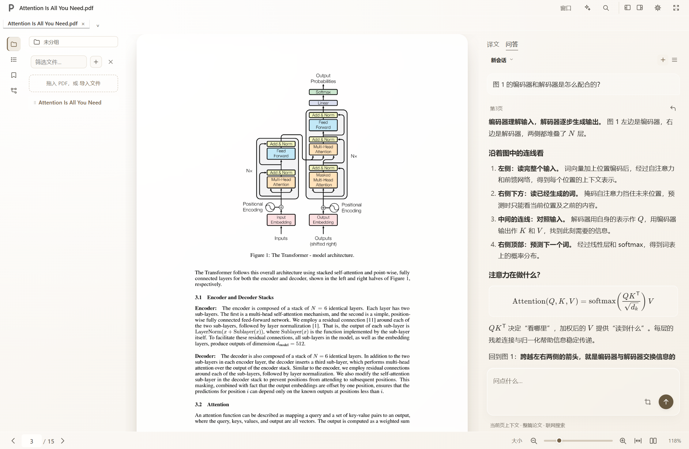
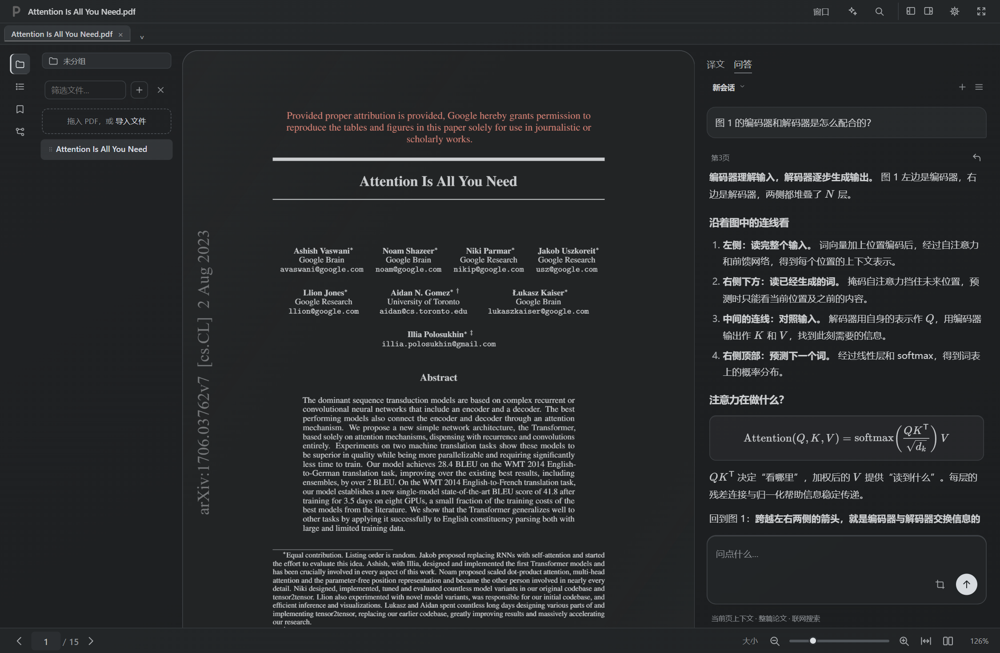

# prt

**在论文旁边，把问题读明白。**

**简体中文** · [English](README.en.md)

面向 Windows 的 PDF 阅读应用，将原文、翻译、跨文件问答与笔记放在同一个工作区。支持安装版与便携版，个人资料保存在本机。

[下载安装版](https://github.com/975952/prt/releases/latest/download/prt-setup.exe) · [便携版](https://github.com/975952/prt/releases/latest/download/prt.exe) · [使用指南](docs/使用说明书.md) · [更新记录](CHANGELOG.md) · [反馈问题](https://github.com/975952/prt/issues/new/choose)

v1.2.5 实际界面；书架使用独立演示数据。[截图说明](docs/assets/README.md)

## 从书架回到阅读

首页集中展示论文和阅读进度：左侧切换**全部论文、最近阅读、未读与文件夹**，右侧搜索文件名或目录。独立的“继续阅读”入口回到上次阅读的位置，导入与整理入口始终可见。阅读时可随时点击顶栏“首页”浏览书架，再点标签继续阅读；原来的位置、缩放与后台生成保留。

论文为 [Attention Is All You Need](https://arxiv.org/abs/1706.03762)；右侧问答是演示内容。

## 为阅读准备的工作区

| 从阅读到理解 | 在 prt 中完成 |
| --- | --- |
| 找到下一篇论文 | 首页搜索、最近阅读、未读筛选、文件夹导航与继续阅读 |
| 对照多篇论文 | 跨文件夹多标签、独立窗口与窗口平铺，保留阅读位置，刷新后恢复标签顺序 |
| 读懂一段原文 | 划词翻译、解释、原文对照；每条译文可直接删除，点击引用回到对应页面 |
| 看图表与公式 | 框选截图、长截图、视觉模型问答，支持公式与表格排版 |
| 连贯地追问 | 按论文、文件夹或全局管理会话，切换后后台继续生成，跨窗口同步与草稿恢复 |
| 留下阅读线索 | 全文搜索、目录、高亮笔记与参考文献检索 |
| 调整阅读观感 | 适应宽度铺满阅读区，全屏保留导航；透光、米宣与深色主题及可调玻璃材质 |
| 使用自己的语言 | 简体中文 / English 全局界面；回答语言与翻译目标分别设置 |

## 开始使用

1. 从 [Releases](https://github.com/975952/prt/releases/latest) 下载 **prt-setup.exe**，按向导安装到当前 Windows 账户，无需管理员权限。
2. 从开始菜单或桌面快捷方式打开 **prt**，拖入 PDF 或点击导入，即可阅读、搜索和记笔记。
3. 需要翻译或问答时，在设置中填写 **OpenAI 兼容接口地址、模型名和 API Key**。图表与扫描件需要支持图像的模型。

首次使用默认显示 English，可在 **Settings → Language / 语言** 中切换简体中文或 English。界面切换会保存当前阅读位置、会话和草稿；回答语言可跟随界面或独立选择，翻译目标保持单独设置。

支持 Windows 10/11 x64，无需 Node.js，需要 [Microsoft WebView2 Runtime](https://developer.microsoft.com/microsoft-edge/webview2/)（多数系统已安装）。安装器会检查运行环境；模型服务由你自行配置，服务费用按对应提供商规则计算。需要免安装或放在移动硬盘时，下载 **prt.exe** 到可写文件夹即可。

**当前版本：** [v1.3.0](https://github.com/975952/prt/releases/tag/v1.3.0)。新增 Windows 安装向导、开始菜单与桌面快捷方式、升级与卸载入口。安装版将程序、论文和会话分开保存；升级不覆盖资料，卸载保留个人数据。首次安装可选择旧便携版所在目录，复制论文、设置和会话，原目录保持完整。

跨文件夹切换保留已打开的标签，刷新后恢复原顺序；全屏保留标签栏与“首页”入口，回首页后任务继续生成。**Fit width / 适应宽度** 铺满阅读区可用宽度，开关侧栏和调整窗口时继续贴合。

跨文件问答先定位目标资料，指定页只读该页，扫描页直接读图；多文件比较分别保留页码。生成跟随所属会话，切换文件或会话时继续运行；停止、重试和保存分别校验任务归属，防止迟到内容串入其他对话或覆盖新答案。

默认外观已更新：阅读字号 17px、首页缩放 140%，纸面透明度 16%、界面透明度 100%，背景亮度 92%。在 **设置 → 阅读外观** 可继续调整。**译文卡片材质**提供液态玻璃与磨砂玻璃，两种材质分别记住参数：液态默认通透度 35%、雾化 11.4px、边缘折射 99%；磨砂默认通透度 71%、雾化 9.4px。完整参数见[使用指南](docs/使用说明书.md#外观与舒适度)。

会话默认按论文分别管理，历史默认按时间排列。在设置中选择按文件夹共享后，同文件夹内可延续一段对话；未分组文件也作为同一个公共文件夹共享会话。

本版也包含近期的阅读修复：输入框光影更明显，背景亮度范围提高到 92%–100%；多条译文最多三条同时生成、按发起顺序排列；窄栏论文不再混选相邻栏文字，深色阅读保留淡彩色底框的原有色相。引用卡片和参考文献列表中的“浏览器搜索论文”直接打开默认浏览器，使用 Bing 搜索。

安装版升级时退出 prt，再运行新的 **prt-setup.exe**。便携版升级仍只替换原位置的 **prt.exe**，保留 `papers/` 和 `data/`。下载页提供源码包与 `SHA256SUMS.txt` 校验文件。

查看两种译文卡片、米宣与深色主题

### 液态玻璃译文卡片

### 磨砂玻璃译文卡片

### 深色首页

### 米宣

### 深色

## 数据由你保管

| 内容 | 安装版默认位置 | 便携版位置 |
| --- | --- | --- |
| 应用程序 | `%LOCALAPPDATA%\Programs\prt` | `prt.exe` 所在目录 |
| 论文库 | 系统“文档”目录下的 `prt\papers` | 程序旁的 `papers/` |
| 设置、笔记、会话、API Key 与窗口数据 | `%LOCALAPPDATA%\prt\data` | 程序旁的 `data/` |

系统“文档”目录若已重定向到其他磁盘或 OneDrive，安装版会跟随系统位置。备份时退出 prt，将论文库与数据目录一起复制；卸载不会删除这两个目录。API Key 作为本地配置保存，不应公开上传数据目录。旧版迁移只向空目标复制，不会合并覆盖已存在的资料；迁移的源和目标需要是普通本地目录，遇到链接、联接点或云端占位路径会停止并提示。完整步骤见[使用指南](docs/使用说明书.md#数据备份与升级)。

本地服务只监听 `127.0.0.1`。阅读、搜索和笔记不需要模型服务；使用 AI 时，相关原文、截图及对话上下文会发送到你配置的接口，联网检索会向检索服务发送查询。AI 输出可能有误，可通过引用回到原文核对。

## 帮助与反馈

- **使用：** [使用指南](docs/使用说明书.md) · [多窗口阅读](docs/多窗口阅读.md) · [常见问题](docs/使用说明书.md#常见问题)
- **反馈：** [报告问题或提出建议](https://github.com/975952/prt/issues/new/choose) · [安全问题](SECURITY.md)
- **参与：** [贡献指南](CONTRIBUTING.md) · [文档索引](docs/README.md)

## 许可证

项目代码采用 [MIT License](LICENSE)。第三方组件、字体和论文分别遵循各自的授权；截图中的论文不属于本项目的 MIT 授权范围。参见 [第三方组件](docs/第三方组件.md)。
